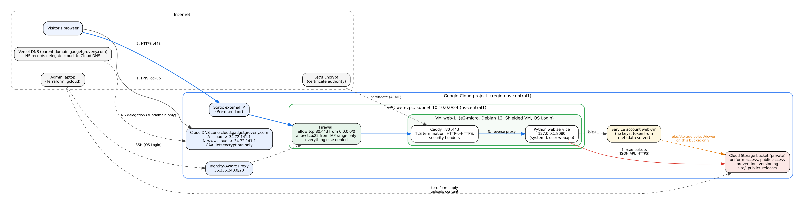

# AI 255 Project 1: First Cloud Deployment

Shafkat Khalek Khan. AI 255 Cloud Computing Concepts, Prof. Yair Chaya, Fall 2026.

**Live endpoint:** {{URL}}
**Provider:** Google Cloud, region us-central1 (Iowa). **Infrastructure as code:** Terraform (`infra/`).

## 1. Summary

I deployed a small web service on Google Cloud. It runs on a Compute Engine VM, reads its page and files from a private Cloud Storage bucket, is reachable at `cloud.gadgetgroveny.com`, a subdomain of my store's domain that is served by Cloud DNS, and is served only over HTTPS with a Let's Encrypt certificate. The VM runs under its own service account, which can read objects in that one bucket and do nothing else. Everything is created by Terraform, so the whole setup can be removed with `terraform destroy` and created again with `terraform apply`.

The deliverables are the live endpoint above, the architecture diagram in Section 2, and the cost estimate at three traffic levels in Section 5.

## 2. Architecture

| Requirement | Google Cloud service | What I configured |
|---|---|---|
| Compute | Compute Engine | VM `web-1`, e2-micro, Debian 12, 10 GB standard disk, Shielded VM, OS Login |
| Object storage | Cloud Storage | private bucket `<project>-web-content`: the web page, the files the service shows, and the app release |
| DNS | Cloud DNS | public zone for `cloud.gadgetgroveny.com`: A records for the name and its `www`, a CAA record. The parent domain stays on Vercel DNS, which delegates the subdomain to Cloud DNS with four NS records |
| TLS | Caddy + Let's Encrypt | certificate issued and renewed automatically; HTTP redirected to HTTPS |
| Scoped IAM | IAM | service account `web-vm` with `roles/storage.objectViewer` on the bucket only |
| Network | VPC | custom VPC and subnet, firewall allows only 80/443 from the internet and 22 from Google's IAP range |

How a request is served:

1. The browser looks up `cloud.gadgetgroveny.com`. Vercel DNS, which serves the parent domain `gadgetgroveny.com`, refers the query to Cloud DNS through NS records for `cloud`, and Cloud DNS answers with the VM's static IP.
2. The browser connects on port 443. The firewall lets 80 and 443 through. Caddy on the VM terminates TLS, adds security headers, and forwards the request to the Python service on `127.0.0.1:8080`. A request on port 80 gets a redirect to HTTPS.
3. The Python service reads the page and files from the bucket through the Cloud Storage JSON API, using an access token for the `web-vm` service account that it gets from the VM's metadata server. It caches the page and the file list for 60 seconds.

The service has five routes: `/` (web page), `/api/health`, `/api/info` (VM name, zone, version, uptime), `/api/files` (files in the bucket) and `/files/<name>` (one file). It uses only the Python standard library, so nothing is installed with pip on the VM.

## 3. Design decisions

* **A VM instead of Cloud Run or App Engine.** The project asks for compute, storage and DNS that I configure myself. A VM makes every layer visible: the network, the firewall, the TLS setup and the identity the code runs as. Cloud Run would have hidden most of this.
* **e2-micro in us-central1.** One e2-micro in us-central1, us-east1 or us-west1 is covered by Google Cloud's free tier, and so are 30 GB of standard disk. I chose us-central1 because the price tables I used for the cost estimate list us-central1 prices.
* **Caddy and Let's Encrypt for TLS.** A Google-managed certificate needs a load balancer, and the load balancer's forwarding rule alone costs about $18 per month. Caddy gets a free Let's Encrypt certificate, renews it before it expires, and redirects HTTP to HTTPS, with a ten-line configuration. The load balancer becomes worth it at the high traffic level (Section 5).
* **Delegating a subdomain instead of the whole domain.** `gadgetgroveny.com` already runs my online store on Vercel. Moving the whole domain to Cloud DNS would have broken the store, so I gave Google only `cloud.gadgetgroveny.com` by adding four NS records for `cloud` in Vercel DNS. Cloud DNS is authoritative for the subdomain and the store is not affected.
* **Static external IP.** The DNS records point at this address, so it must not change when the VM restarts.
* **Custom VPC instead of the default network.** The default network comes with firewall rules that allow SSH and RDP from anywhere. In my VPC only the two rules I wrote exist, and all other incoming traffic is denied.
* **Private bucket, served through the VM.** The bucket is not public: public access prevention is enforced, and access is controlled by IAM only (uniform bucket-level access). Visitors get files through the web service. Versioning is on, so an overwritten or deleted object can be restored.
* **The app release lives in the bucket.** Terraform uploads `app/server.py` to `release/server.py`, and the VM downloads it at every boot. Updating the app means `terraform apply` and a VM reset; nothing is copied to the VM by hand.

## 4. Security

### Identity and access (least privilege)

| Identity | Role | Granted on | Why |
|---|---|---|---|
| `web-vm` service account (the VM) | `roles/storage.objectViewer` | the content bucket only | the service only needs to read the page, files and release |
| My Google account (administrator) | Owner (project creator) | the project | runs Terraform; not used by the running system |

The VM does not use the Compute Engine default service account, which in many projects has the broad Editor role. `web-vm` has no project-level roles at all. It cannot write or delete objects, cannot see other buckets, and cannot call other Google Cloud APIs. There are no service account keys anywhere: the VM gets short-lived tokens from the metadata server. Section 6 shows the test I ran on the VM to prove this.

### Network and host

* Firewall: TCP 80 and 443 from anywhere (port 80 is needed for the Let's Encrypt HTTP check and for the redirect), TCP 22 only from 35.235.240.0/20, the range Google's Identity-Aware Proxy uses. SSH is therefore not open to the internet.
* OS Login: who may SSH is decided by IAM, so there are no SSH keys in instance metadata.
* Shielded VM: Secure Boot, vTPM and integrity monitoring are on.
* The Python service listens on `127.0.0.1` only and runs as an unprivileged `webapp` user, under a systemd unit that blocks privilege escalation and makes the file system read-only for it.
* The service only answers GET and HEAD, and file names are checked against a strict pattern, so requests such as `/files/../site/index.html` are rejected.

### Encryption

* In transit, public side: HTTPS with a Let's Encrypt certificate. HTTP is redirected to HTTPS, and the `Strict-Transport-Security` header tells browsers to use HTTPS for a year.
* In transit, VM to Cloud Storage: the JSON API is only available over HTTPS.
* At rest: Cloud Storage and persistent disks are encrypted by Google by default.
* Extra headers: `X-Content-Type-Options: nosniff`, `X-Frame-Options: DENY`, `Referrer-Policy: no-referrer`, and the `Server` header is removed.
* A CAA record allows only Let's Encrypt to issue certificates for the domain.

## 5. Cost estimate at three traffic levels

{{COST}}

**What drives the cost.** At low and medium traffic the VM, disk and storage are free and almost the whole bill is the static IP address ($3.65 per month), which the free tier does not cover, plus $0.20 for the DNS zone. Egress (data sent to visitors) is what grows with traffic: at the medium level it is already the largest item, and at the high level it is about three quarters of the bill.

**Why the high level uses a different design.** At peaks of about 60 requests per second, one shared-core e2-micro is a single point of failure with no spare capacity. Two e2-small VMs behind a global HTTPS load balancer survive the loss of one VM, and the load balancer provides a Google-managed certificate. The load balancer adds about $18 per month for its forwarding rule plus $0.008 per GiB processed.

**Ways to lower the cost:**
* Cloud CDN in front of the load balancer: cached responses are billed at the CDN egress price ($0.08 per GiB for the first 10 TiB in North America) instead of $0.12 per GiB.
* Smaller responses: egress is proportional to the average response size, which I assumed to be 50 KB. Compression (Caddy already applies gzip) and image optimisation reduce it directly.
* Standard network tier instead of Premium, for lower egress prices at the cost of routing over the public internet.
* A budget alert in the billing console, so an unexpected traffic spike is noticed early.

## 6. Verification

{{VERIFY}}

### IAM check, run on the VM

`gcloud compute ssh web-1 --zone us-central1-a --tunnel-through-iap --command iam-check` asks Google Cloud directly what the VM's service account is allowed to do:

{{IAM_CHECK}}

## 7. Testing

* `app/test_server.py` (pytest): every route, the fallback page, path traversal attempts, storage errors (HTTP 502 instead of a crash), the 60-second cache, the Cloud Storage backend against a simulated metadata server and API (token reuse, URL encoding, 403 and 404 handling), and a real HTTP server on a local port (GET, HEAD, and 405 for POST).
* `scripts/test_verify.py`: the verification script against a simulated deployment, including failure cases (wrong DNS, wrong certificate issuer, public bucket, missing HSTS header).
* `cost/test_cost_model.py`: the tiered egress prices, the cache limit on storage operations, and that every price has a source.
* Infrastructure: `terraform validate` and `terraform plan` before every apply. The VM startup script was checked with ShellCheck.

## 8. Limitations and what I would do next

* One VM in one zone is a single point of failure. If the zone or the VM fails, the site is down until the VM is recreated. The high-traffic design fixes this with a managed instance group behind a load balancer.
* The VM reaches the internet for package installs and Let's Encrypt. Without an external IP it would need Cloud NAT.
* Logs stay on the VM (journald). The next step is the Ops Agent with a log-writer role, which Project 4 covers.
* Updating the app needs a VM reset, which means a short outage. A rolling update across a managed instance group would avoid that.
* The cost estimate depends on my assumptions, mainly the 50 KB average response. Egress scales linearly with it.
* Terraform state is a local file. In a team it should be stored in a Cloud Storage backend with locking.

## 9. How to reproduce and tear down

See `README.md` for every command. In short: `terraform apply` in `infra/`, add the four Cloud DNS name servers as NS records for the subdomain at the parent domain's DNS host (here Vercel), wait for DNS, then run `python scripts/verify.py --from-terraform infra`. `terraform destroy` removes everything, including the bucket and its objects.

## 10. Use of generative AI

I used Claude (Anthropic) as an assistant while writing the code, the Terraform files, the scripts and this report. I deployed and tested the system myself, and I can explain every resource, setting and number in this report.
